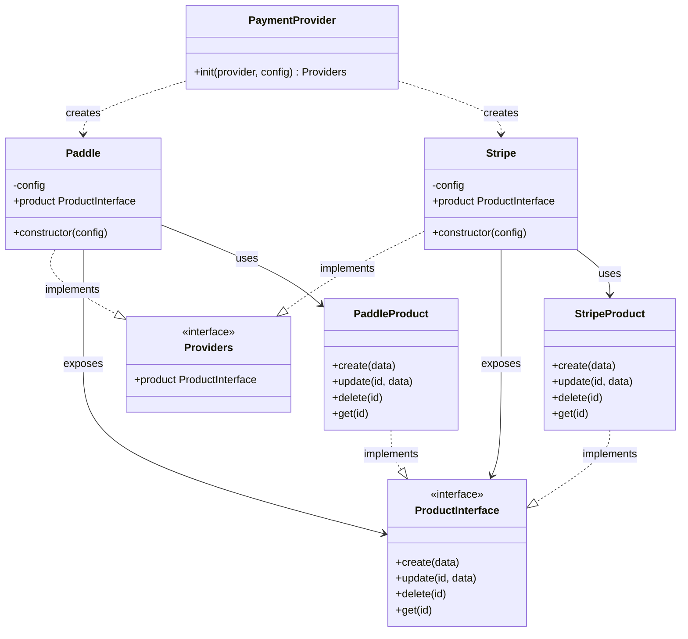
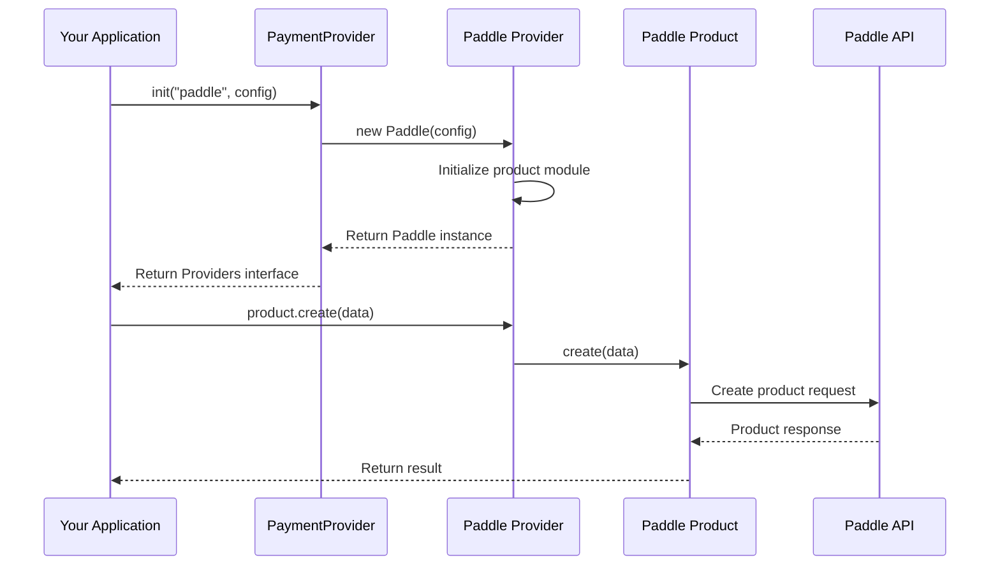

# Payment Gateway Providers

This project uses two main design patterns: Adapter Pattern and Factory Pattern.

This architecture makes the payment integration modular, reusable, and extensible. That allows new payment providers to be added without changing the application's core business logic.

## Architecture diagram (Class Diagram)

## Execution flow (Sequence Diagram)

## Documentation

- [Adding a payment provider](docs/adding-a-provider.md) — the required structure, contracts, registration step, and provider template.
- [Design-pattern concept](design-pattern-concept.md) — gateway API inventories used when deciding which common capabilities to introduce.
