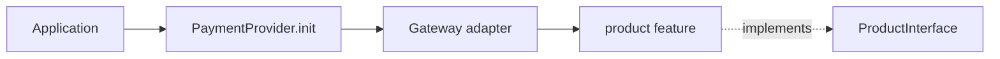

# Adding a payment provider

This guide defines the provider-extension pattern used in this repository. Follow it when adding Stripe, PayPal, or another gateway so application code can use one stable public shape regardless of the selected gateway.

## The pattern

`PaymentProvider` is the composition root. It selects one gateway adapter, and the adapter exposes feature objects that implement shared core contracts.



The source files have distinct responsibilities:

| Location | Responsibility |
| --- | --- |
| `provider.ts` | Public factory; imports and selects registered gateway adapters. |
| `payment/providers.ts` | The public provider surface. Add a feature here only after it is a capability the library supports across providers. |
| `payment/core/*.ts` | Contracts for individual features, such as `ProductInterface`. These define what consumers may call. |
| `payment/providers/<provider>/index.ts` | One gateway adapter. It implements `Providers` and wires its feature implementations together. |
| `payment/providers/<provider>/<feature>.ts` | Gateway-specific implementation of one core contract. It contains the gateway SDK/API logic and imports the core contract, never another provider's implementation. |

The dependency direction must stay one-way:

```text
provider.ts -> gateway adapter -> gateway feature -> core contract
                         \-> Providers contract
```

Provider-specific code must not leak into `payment/core` or `payment/providers.ts`. Those files describe the normalized API, not a particular gateway's API.

## Before adding a feature

Do not copy every endpoint from a gateway into the shared API. First decide whether the operation has a clear, useful meaning for every provider the library intends to support.

1. Define the normalized request, response, and failure behavior.
2. Add or update the appropriate contract under `payment/core/`.
3. Add the feature property to `Providers` only when every registered provider can implement it.
4. Implement the contract for every registered provider in the same change, or keep the feature out of the public `Providers` surface until that work is ready.

This prevents `payment.product` from promising an operation that only works for one gateway.

## Add a gateway: checklist

For this example the new gateway identifier is `acme-pay` and its class name is `AcmePay`.

1. Create `payment/providers/acme-pay/`.
2. Create one file per supported feature, such as `product.ts`.
3. Make each feature class implement its matching core interface.
4. Create `index.ts`; make the adapter implement `Providers` and expose every required feature as a `public` property.
5. Accept the gateway configuration in the adapter constructor and pass the relevant configuration to its feature objects.
6. Import the adapter in `provider.ts` and add exactly one lower-case provider identifier to the `switch` in `PaymentProvider.init`.
7. Add a test that constructs the provider through the factory and verifies the expected feature is available. Add behavior tests with the gateway client mocked.
8. Update the README's supported-provider list when the adapter is usable.

## Reference implementation

This is the expected shape for a new provider using the current `product` contract.

```ts
// payment/providers/acme-pay/product.ts
import ProductInterface from "../../core/product";

export default class AcmePayProduct implements ProductInterface {
    constructor(private readonly config: object) {}

    public create(): void {
        // Translate the normalized operation into the Acme Pay API call.
        // Do not expose Acme Pay response objects from this public method.
    }
}
```

```ts
// payment/providers/acme-pay/index.ts
import Providers from "../../providers";
import Product from "./product";
import ProductInterface from "../../core/product";

export default class AcmePay implements Providers {
    public product: ProductInterface;

    constructor(config: object) {
        this.product = new Product(config);
    }
}
```

```ts
// provider.ts
import AcmePay from "./payment/providers/acme-pay";

// Inside PaymentProvider.init(...)
case "acme-pay":
    return new AcmePay(config);
```

Keep the same conventions in new code:

- Gateway IDs are lower-case strings used in the factory; adapter and feature classes use PascalCase.
- Adapters own feature construction. Consumers must receive a provider only through `PaymentProvider.init`, rather than constructing feature classes directly.
- Feature properties are public and typed to the shared interface (`ProductInterface`), not to the gateway-specific class.
- Constructors receive configuration; public feature methods perform the provider operation. Avoid module-level clients or credentials.
- A gateway adapter may contain wiring and configuration validation, but provider API calls belong in feature classes.
- Methods that perform network work should be `async` and return normalized typed results once the core contract is expanded to support them.

## The current `create()` method

`ProductInterface#create()` exists only as a scaffold to prove the wiring between the factory, adapter, and feature class. The Paddle implementation only logs a message. It has no input, makes no API request, and returns no payment/product data.

Do **not** use it as the design for a real remote "create product" method, and do not build production code that depends on it. When product creation becomes a real library capability, replace the scaffold deliberately:

1. Define named request and response types in the core product module.
2. Change the shared contract to an asynchronous method, for example `create(input: CreateProductInput): Promise<Product>`.
3. Update every provider adapter's product implementation in the same change.
4. Normalize provider errors and test both the translated request and normalized response.

Until then, retain `create(): void` only for local wiring/demo tests.

## Configuration and error rules

The current constructor signature is `config: object`, so adding a provider must not assume a global set of keys. Validate the configuration required by that provider at the adapter boundary and keep secrets private. The existing Paddle scaffold accepts but does not yet use its configuration; a functional provider must pass configuration to the API client or feature implementation.

Unsupported gateway IDs must continue to fail through the factory's `Unsupported provider: <id>` error. Do not silently fall back to another gateway.

As the project matures, prefer replacing the broad `object` type with provider-specific config types and a typed provider-name union. Make that a coordinated contract change rather than weakening individual adapters with `any`.

## Definition of done

A provider addition is complete when it has:

- an adapter implementing every current `Providers` member;
- a separate implementation for each required core feature;
- factory registration and a stable provider ID;
- configuration validation with no secrets logged;
- unit tests for factory selection and feature behavior; and
- README documentation of support level and any intentionally unsupported capabilities.
